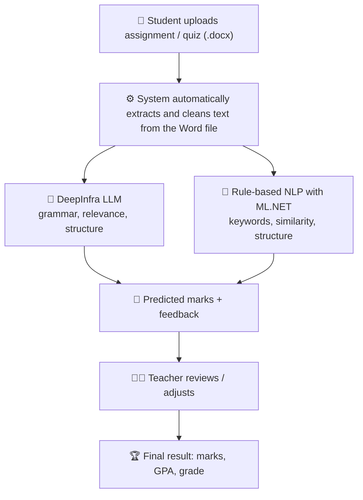

<div align="center">


<a href="https://github.com/Usamashoaibkhan/Automated-Student-Grading-System">
  
</a>

<br/>

**An AI-powered, role-based web platform that automatically evaluates Word-based assignments and quizzes using NLP and Large Language Models.**

<br/>


<br/><br/>


</div>


## 📌 Overview

> Manual grading is slow, inconsistent and delays student feedback.

This system solves that by combining **automated NLP-based grading** with **instructor review**, so grading is fast, fair and transparent.

Students submit their work as **Word (`.docx`) files**, and the system **automatically reads and evaluates the Word file on its own**, assigning marks and generating feedback using an LLM and a rule-based engine. Teachers can then review, adjust and publish the final results. Students see their marks, GPA, grade and personalised feedback in their own dashboard.


## 🎬 Demo

<div align="center">

<a href="https://drive.google.com/file/d/1OAUfslDyeX8Gy8vxNZ1dXmRGcfecWy8W/view?usp=drive_link"></a>
<a href="https://drive.google.com/file/d/1PzGv9T7Gh7-9kijBqL4RPdfv9r3TUpcG/view?usp=drive_link"></a>

</div>


## ✨ Features

<table>
<tr>
<td width="33%" valign="top">

### 👨‍💼 Admin
- Manage departments, subjects, semester-wise subjects, teachers and students
- View, update and delete student results
- Dashboard with institution-wide summary

</td>
<td width="33%" valign="top">

### 👩‍🏫 Teacher
- Upload assignments with due dates and track student submissions
- **Automatic evaluation of Word files**: the system reads the submitted `.docx` itself and assigns marks using NLP, for both assignments and quizzes
- Manual override of predicted marks and custom feedback
- Enter attendance, midterm and final marks; **total, GPA and grade** are calculated automatically
- Visual dashboard with grade distribution and GPA charts
- **At-risk student detection** (GPA below 2.0) with direct feedback messaging

</td>
<td width="33%" valign="top">

### 🎓 Student
- View assignments, deadlines and submission status
- Upload answers in `.docx` format
- View detailed results and teacher feedback
- Reply to teachers through the notification module

</td>
</tr>
</table>


## 🧠 How the Grading Works



This hybrid approach combines the context awareness of an LLM with the transparency of rule-based scoring.


## 🛠️ Tech Stack

<div align="center">


<br/><br/>


</div>

<br/>

| Layer | Technology |
|:---|:---|
| ⚙️ Backend | C#, ASP.NET Core MVC, Entity Framework Core |
| 🎨 Frontend | HTML, CSS, JavaScript, Bootstrap |
| 🗄️ Database | Microsoft SQL Server |
| 🤖 AI / NLP | DeepInfra API (Meta-LLaMA 3 8B Instruct), ML.NET, OpenXML SDK |
| 🧰 Tools | Visual Studio 2022, GitHub |


## 🗂️ Project Structure

```
Test2/
├── Controllers/    Request handling and business logic
├── Models/         Academic entities (Student, Teacher, Subject, ...)
├── ViewModels/     Data passed to views
├── Views/          Razor views for Admin, Teacher and Student
├── Data/           Database context
├── wwwroot/        Static files (CSS, JS, images)
├── Program.cs
├── appsettings.json
└── script.sql      Database script
Test2.sln           Visual Studio solution
```


## 🚀 Getting Started

### Prerequisites
- Visual Studio 2022 (ASP.NET workload)
- .NET SDK matching `Test2.csproj`
- Microsoft SQL Server
- A DeepInfra API key

### Installation

1. **Clone the repository**

```bash
git clone https://github.com/Usamashoaibkhan/Automated-Student-Grading-System.git
```

2. **Open** `Test2.sln` in Visual Studio 2022.
3. **Create the database** by running `Test2/script.sql` in SQL Server.
4. **Configure** `Test2/appsettings.json` with your own database connection string and DeepInfra API key.
5. **Run** the project with `F5`.

> ⚠️ Never commit real API keys or passwords. Use your own credentials locally.


## 🔐 User Roles

| Role | Access |
|:---|:---|
| 👨‍💼 Admin | System, academic data and result management |
| 👩‍🏫 Teacher | Assignments, quizzes, NLP grading, results and feedback |
| 🎓 Student | Submissions, results and feedback |

Each role has its own secure login and dashboard.


## ⚠️ Limitations & Future Work

**Current scope**
- Automatically evaluates **online Word-based (`.docx`) assignments and quizzes** using NLP and assigns marks with feedback
- Attendance, midterm and final marks are entered by the teacher; the system calculates total marks, GPA and grade automatically

**Limitations**
- Only online, text-based submissions are graded
- Plagiarism detection is not included yet

**Planned improvements:** domain-specific NLP tuning, plagiarism detection, advanced analytics, a mobile app and personalised AI recommendations.


## 👤 Author

**Usama Shoaib**
BS Computer Science (2021-2025), University of Southern Punjab, Multan

<a href="https://github.com/Usamashoaibkhan"></a>
<a href="https://www.linkedin.com/in/usama-shoaib-45a521259/"></a>

<div align="center">


</div>
